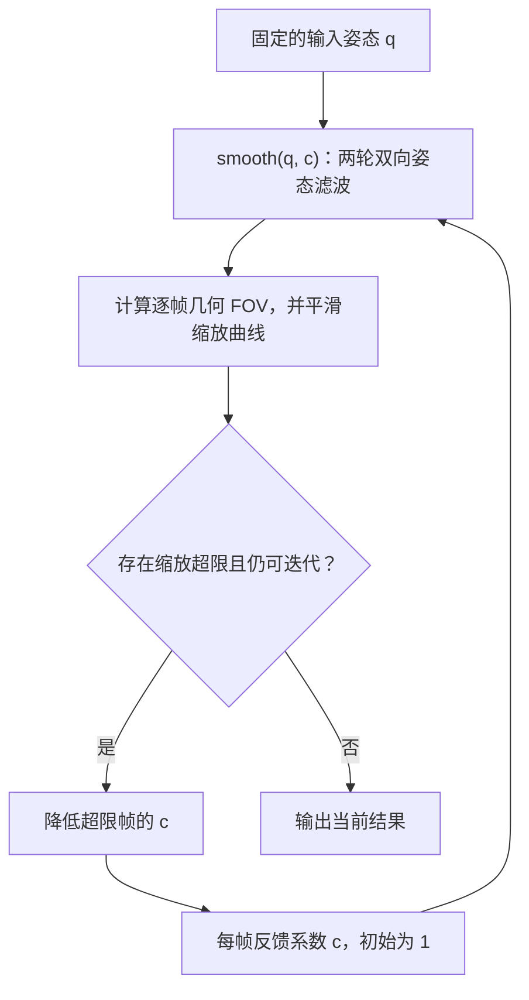

# Gyroflow 全局姿态平滑与最大缩放限制迭代

本文整理 Gyroflow 默认姿态平滑算法及最大缩放限制的实现，重点说明数据流、滤波系数、两轮双向平滑、外层反馈迭代，以及全序列扫描次数。

- 源码版本：`2331ebb3c253fc7cf357642518b0c8bf2937f815`。
- 本地源码：`../.agents/gyroflow_reference_2331ebb/`。
- 分析对象：`DefaultAlgo::smooth()`，即本文讨论的 global smooth。
- 主线假设：`per_axis = false`、`second_pass = true`、参数固定、视频为正常速度，按从头计算的路径解释。
- 为突出主线，公式省略关键帧、裁剪区间、附加旋转和地平线锁定等预处理，以及缓存和取消计算逻辑；相关边界在后文说明。

## 1. 两层计算及其数据关系

整个过程包含两层：

1. **单次平滑内部**：角速度自适应的第一轮双向姿态滤波，以及由姿态偏差调节的第二轮双向姿态滤波。
2. **最大缩放限制外层**：检查当前结果需要的缩放，降低超限帧的反馈系数，重新计算整段姿态平滑和缩放曲线。

内部第二轮接着处理第一轮的姿态结果；外层重算时，重新从同一份原始姿态开始，沿用更新后的每帧反馈系数。



流程图中的 `c` 只在开始时初始化为 1；循环内保留并累计更新它。迭代次数耗尽时，即使仍有超限，也会输出当前结果。

## 2. 符号与默认参数

姿态平滑按运动数据的采样点进行，缩放检查按视频帧进行。两者数量和采样频率可以不同。

| 符号 | 含义 |
|---|---|
| $i$ | 姿态四元数采样点索引 |
| $j(i)$ | 代码按采样时间映射到的视频帧索引 |
| $q_i$ | 传入平滑算法的姿态，已完成需要的预处理 |
| $P_i$ | 第一轮双向姿态滤波的结果 |
| $S_i$ | 第二轮双向姿态滤波后的最终姿态 |
| $f_s$ | 姿态数据的平均采样率 |
| $s$ | `smoothness`，整体平滑强度 |
| $\phi_j$ | 镜头对角视场角，单位为度 |
| $c_j$ | 每个视频帧的缩放限制反馈系数 |
| $F_j$ | 经过缩放模式处理后，用于外层检查的无量纲 FOV 系数 |

本文涉及的主要默认值为：

| 参数 | 默认值 | 含义 |
|---|---:|---|
| `smoothness` | 0.5 | 整体平滑强度，界面按 50% 显示 |
| `max_smoothness` | 1.0 s | 低角速度处采用的时间常数 |
| `alpha_0_1s` | 0.1 s | 高角速度参考点的时间常数，也用于角速度和偏差曲线的平滑 |
| `second_pass` | true | 启用第二轮姿态平滑 |
| `per_axis` | false | 默认直接在四元数旋转上做整体平滑 |
| `MAX_VELOCITY` | 500 deg/s | 参考速度的基础值 |
| `FOV_REFERENCE` | 120° | 镜头视场角归一化基准 |
| `max_zoom` | 130% | 最大缩放目标 |
| `max_zoom_iterations` | 5 | 外层最多追加的反馈调整次数 |

配置项 `alpha_0_1s` 保存的是时间常数，单位为秒。经过 `get_alpha()` 换算后，才得到实际滤波系数。

## 3. 一次 `smooth()` 内部发生了什么

本节对应 [默认算法源码][source-default]。

### 3.1 基本算子：按系数跟随当前姿态

单向姿态滤波的基本递推为：

$$
p_i=\operatorname{slerp}(p_{i-1},q_i,\alpha_i)
$$

`SLERP` 表示四元数球面插值，即从上一个平滑姿态向当前输入姿态移动一部分。

- $\alpha_i$ 越小，更多延续之前的姿态，平滑越强。
- $\alpha_i$ 越大，越快跟随当前输入，平滑越弱。
- $\alpha_i=1$ 时，这一遍直接采用当前输入。

时间常数与指数滤波系数之间的换算为：

$$
a(\tau)=1-e^{-\Delta t/\tau},\qquad \Delta t=1/f_s
$$

记默认的两个基准系数为：

$$
a_s=a(1.0\text{ s}),\qquad a_f=a(0.1\text{ s})
$$

默认情况下 $a_s<a_f$。代码在这两个系数之间插值或外推；插值对象是系数 $a$，不是时间常数 $\tau$。

### 3.2 计算角速度，并对角速度做双向平滑

代码先估计平均采样率：

$$
f_s=\frac{N}{T}
$$

其中 $N$ 为四元数数量，$T$ 为传入的总时长，单位为秒。相邻姿态的旋转差为：

$$
\Delta q_i=q_{i-1}^{-1}q_i
$$

不分轴时，角速度大小估计为：

$$
\omega_i=\operatorname{angle}(\Delta q_i)\cdot f_s\cdot\frac{180}{\pi}
$$

首个点的速度设为零。这里使用平均采样率，没有逐点除以实际时间戳之差。

随后使用 $a_f$ 对角速度曲线做前向指数平滑：

$$
v_i^{\rightarrow}=(1-a_f)v_{i-1}^{\rightarrow}+a_f\omega_i
$$

再从末尾往回处理前向结果：

$$
\bar\omega_i=(1-a_f)\bar\omega_{i+1}+a_fv_i^{\rightarrow}
$$

这样得到的角速度曲线更平缓，用于避免滤波强度随瞬时角速度尖峰剧烈变化。

### 3.3 将角速度转成自适应滤波系数

默认开启第二轮时，参考速度为：

$$
V_i=500\cdot s\cdot\frac{\phi_{j(i)}}{120^\circ}\cdot c_{j(i)}\cdot0.5
$$

最后的 $0.5$ 是开启第二轮时使用的补偿。源码注释说明，其目的是使两轮处理的最大缩放接近不启用第二轮时的水平。

首次完整计算尚无缩放反馈时，可以将 $c_j$ 视为 1。代码使用 `smoothing_fov_limit_per_frame` 保存这些系数，并按姿态采样时间查询对应视频帧。

归一化速度为：

$$
r_i=\frac{\bar\omega_i}{V_i}
$$

第一轮的姿态滤波系数为：

$$
\alpha_i^{(1)}=\min\left(1,\;a_s+(a_f-a_s)r_i\right)
$$

其作用可以沿公式直接理解：

- 角速度低：$r_i$ 小，系数接近 $a_s$，平滑较强。
- 角速度高：系数增大，输出更快跟随输入运动。
- 增大 $s$：参考速度增大，$r_i$ 减小，平滑增强。
- 减小镜头视场角或反馈系数 $c_j$：参考速度减小，平滑减弱。

$V_i$ 是归一化参考速度，$r_i$ 可以大于 1。超过参考速度后，系数继续外推，最终通过 `.min(1.0)` 限制上界。

例如 $s=0.5$、$\phi=120^\circ$、$c=1$，参考速度为：

$$
V=500\times0.5\times1\times1\times0.5=125^\circ/\text{s}
$$

### 3.4 第一轮姿态平滑：前向，再反向

前向递推为：

$$
p_i^{\rightarrow}=\operatorname{slerp}\left(p_{i-1}^{\rightarrow},q_i,\alpha_i^{(1)}\right)
$$

前向状态以首个输入姿态初始化。反向状态以前向结果的最后一个姿态初始化，再计算：

$$
P_i=\operatorname{slerp}\left(P_{i+1},p_i^{\rightarrow},\alpha_i^{(1)}\right)
$$

反向处理的是前向结果，两个方向使用同一时刻对应的系数。这样同时利用过去和未来的数据，减轻单向滤波的滞后。

这是一条需要未来数据的处理流程。由于系数随时间变化，且姿态递推使用四元数插值，不应直接套用固定系数线性滤波器的严格零相位结论。

### 3.5 根据第一轮姿态偏差构造第二轮权重

先计算第一轮结果与输入姿态的旋转角度差：

$$
d_i=\operatorname{angle}(q_i^{-1}P_i)
$$

计算偏差时，同时找出整段最大值 $d_{\max}$。随后执行：

1. 归一化：$u_i=d_i/d_{\max}$。
2. 阈值处理：小于 0.5 的 $u_i$ 置零，其余值保留。
3. 使用 $a_f$ 对这条曲线做前向、反向指数平滑，得到 $\tilde u_i$。
4. 再统计一次全局最大值，并将结果映射到 0.5～1。

最后得到权重：

$$
w_i=\frac{1+\tilde u_i/\max_k\tilde u_k}{2}
$$

以上归一化公式按最大值非零的通常情况展开。该版本源码直接除以最大值；完全静止等退化输入的具体浮点行为需要另行核对。

这里的偏差只衡量姿态旋转角度。实际画面覆盖范围和裁剪需求由外层的几何计算判断。

两次归一化都使用了全局最大值，因此一个时段的较大偏差，也可能影响其他时段的第二轮权重。

### 3.6 第二轮姿态平滑：继续处理第一轮结果

第二轮系数为：

$$
\alpha_i^{(2)}=\min\left(1,\;a_s+(a_f-a_s)r_iw_i\right)
$$

使用这条新系数曲线，对第一轮结果 $P_i$ 再做前向、反向姿态滤波，得到 $S_i$。

第一轮偏差较大的区域，$w_i$ 更接近 1，第二轮使用的系数相对较大，增加的平滑较少。偏差较小的区域，$w_i$ 更接近 0.5，第二轮可以进一步加强平滑。

这里沿用的是前面计算的速度比例 $r_i$；代码没有在两轮之间重新从 $P_i$ 估计角速度。

单次调用的姿态数据流为：

```text
输入姿态 q
    → 第一轮前向
    → 第一轮反向，得到 P
    → 计算 P 相对 q 的偏差，构造第二轮系数
    → 第二轮前向，输入为 P
    → 第二轮反向，得到 S
```

## 4. 从平滑姿态计算裁剪需求

### 4.1 平滑姿态转为校正旋转

上游 `GyroSource::recompute_smoothness()` 从原始姿态开始，应用需要的附加旋转和地平线锁定，再调用平滑算法。

平滑结束后，代码将输出姿态转换为：

$$
C_i=S_i^{-1}q_i^{\mathrm{raw}}
$$

这一步后，`gyro.smoothed_quaternions` 保存的是供后续变换使用的校正四元数。阅读外层写回代码时，需要区分这个字段与数学意义上的平滑姿态 $S_i$。参见 [姿态调用与转换源码][source-gyro]。

### 4.2 几何 FOV 与动态缩放曲线

姿态校正可能使变换后的画面边缘露出空白。Gyroflow 使用图像边界采样点，结合姿态校正、镜头畸变和滚动快门等因素，估计每帧适合的裁剪窗口和 FOV 系数。边界附近还有局部细化计算。参见 [几何 FOV 源码][source-fov]。

这个无量纲 FOV 系数与前面的镜头对角视场角 $\phi_j$ 含义不同。一般而言，FOV 系数越小，保留的画面范围越小，需要的放大越多。

随后按缩放模式处理整条曲线：

- 静态缩放：取整段几何 FOV 的最小值作为统一值。
- 动态缩放：对逐帧 FOV 进行时间平滑。
- 关闭缩放：输出的缩放 FOV 曲线设为 1，同时保留逐帧几何估计供其他用途使用。

默认动态缩放算法为 `EnvelopeFollower`。在固定参数情况下，它执行两轮包络处理，每轮先反向、再前向。基本更新形式为：

$$
y_j=\min\left(x_j,\;\beta x_j+(1-\beta)y_{\mathrm{neighbor}}\right)
$$

第一轮的时间常数来自缩放速度参数，默认 4 秒；第二轮为 0.2 秒。取最小值会让结果保持在当前输入所允许的 FOV 范围内，同时将裁剪需求延伸到相邻时段，使缩放过渡更平缓。

**外层最大缩放限制检查的是经过缩放模式处理后的 `params.fovs`，而非直接使用 `minimal_fovs` 中保存的逐帧几何估计。**

参见 [缩放模式入口][source-zoom] 和 [动态缩放实现][source-zoom-dynamic]。

## 5. 最大缩放限制的反馈迭代

本节对应 [外层迭代源码][source-loop]。同步计算路径中也有相同的主要更新规则。

### 5.1 将缩放上限换算成 FOV 下限

记当前用于检查的 FOV 系数为 $F_j$，最大缩放倍率为 $Z_j$，输入和输出宽度之比为：

$$
b=\frac{W_{\mathrm{in}}}{W_{\mathrm{out}}}
$$

代码中的 FOV 下限为：

$$
F_j^{\mathrm{limit}}=\frac{1}{Z_jb}
$$

`max_zoom` 按百分比保存，进入此公式前除以 100。本文忽略视频速度联动和关键帧对 $Z_j$ 的额外调整。

例如输入输出尺寸相同、限制为 130%，则：

$$
F^{\mathrm{limit}}=\frac{1}{1.3}\approx0.7692
$$

若 $F_j<F_j^{\mathrm{limit}}$，说明该帧当前需要的放大超过目标。

### 5.2 累计降低超限帧的反馈系数

外层初始化每帧系数 $c_j=1$。每轮仅对当前超限帧执行：

$$
c_j\leftarrow c_j\cdot\min\left(\frac{F_j}{F_j^{\mathrm{limit}}},t_k\right)
$$

各轮阈值为：

```text
第 1 轮：0.95
第 2 轮：0.90
第 3 轮：0.85
第 4 轮及以后：0.80
```

未超限的帧保留当前系数。超限越严重，$F_j/F_j^{\mathrm{limit}}$ 越小，削减越多。即使只是轻微超限，也会按本轮阈值至少削减当前系数的 5%、10%、15% 或 20%。

这是乘法累计更新。一个此前被削减过的帧，在后续不再超限时，也不会在该循环中自动恢复到 1。

### 5.3 系数如何影响下一次姿态平滑

$c_j$ 会重新进入参考速度公式，形成以下关系：

$$
c_j\downarrow\quad\Rightarrow\quad V_i\downarrow\quad\Rightarrow\quad r_i\uparrow\quad\Rightarrow\quad\alpha_i\uparrow
$$

在默认参数下，这会让相关时段更快跟随输入姿态，争取减少平滑引起的姿态偏差和裁剪需求。外层累计调整的是这条逐帧系数曲线。

实际输出还受双向递推、第二轮偏差权重和缩放曲线平滑影响，所以需要重新计算完整结果，才能知道新的 FOV 是否达标。

### 5.4 一个数值例子

假设输入输出尺寸相同，当前某帧的数据为：

| 项目 | 数值 |
|---|---:|
| 缩放上限 | 1.3 倍 |
| FOV 下限 | 0.7692 |
| 当前 FOV | 0.60 |
| 当前反馈系数 $c_j$ | 1.0 |

在第一轮反馈中：

$$
c_j^{\mathrm{new}}=1\times\min(0.60/0.7692,0.95)=0.78
$$

继续采用前面的默认强度及 120° 镜头视场角例子，参考速度从 $125^\circ/\mathrm{s}$ 变成：

$$
V^{\mathrm{new}}=125\times0.78=97.5^\circ/\mathrm{s}
$$

相同角速度会得到更大的速度比例和第一轮滤波系数，增强对输入运动的跟随。新的 FOV 数值由重新计算得到，不能仅凭这个倍率直接推定已经满足缩放限制。

### 5.5 外层伪代码

以下用于说明从头计算的数据流，省略实际代码中的缓存、预处理和校正四元数写回。

```python
c = ones(frame_count)

S = smooth(original_quaternions, c)
F = compute_and_smooth_zoom_fovs(original_quaternions, S)

thresholds = [0.95, 0.90, 0.85, 0.80]

for k in range(max_zoom_iterations):
    violating_frames = where(F < fov_limit)
    if len(violating_frames) == 0:
        break

    threshold = thresholds[min(k, len(thresholds) - 1)]
    for j in violating_frames:
        c[j] *= min(F[j] / fov_limit[j], threshold)

    S = smooth(original_quaternions, c)
    F = compute_and_smooth_zoom_fovs(original_quaternions, S)
```

每次重算都从同一份原始姿态开始，并重复需要的预处理；外层沿用的是更新后的 $c_j$。在源码中，`recompute_smoothness()` 每次从 `self.quaternions.clone()` 起步。

内部第二轮的输入则是第一轮结果 $P_i$。这是两处重复计算最主要的数据关系区别。

### 5.6 为什么调整局部系数后仍需重新扫描整段

一个采样点的最终结果与多个时刻有关：

- 前向递推会传播到后续采样点。
- 反向递推会传播到此前采样点。
- 第二轮权重使用全局最大姿态偏差进行归一化。
- 动态缩放会将某个时段的裁剪需求传播到相邻时段。

因此 $F_j$ 不只由该帧自己的 $c_j$ 决定。当前实现每轮重新计算整段姿态和缩放曲线，检查新的结果。

没有超限时提前结束；达到最大迭代次数时也结束。这套反馈规则提供近似限制，有限次数下仍可能超限。默认最多追加 5 次调整。

## 6. 全序列扫描次数

### 6.1 单次 `smooth()` 的核心遍历

默认开启第二轮时，按主要遍历循环统计如下。“全序列扫描”包括初始化端点后跳过首个元素的前向或反向循环。

| 顺序 | 处理内容 | 遍历次数 |
|---:|---|---:|
| 1 | 从相邻姿态计算角速度 | 1 |
| 2 | 角速度前向、反向平滑 | 2 |
| 3 | 用参考速度归一化角速度 | 1 |
| 4 | 第一轮姿态前向、反向平滑 | 2 |
| 5 | 计算姿态偏差，同时统计最大值 | 1 |
| 6 | 偏差归一化，并将小于 0.5 的值置零 | 1 |
| 7 | 偏差曲线前向、反向平滑 | 2 |
| 8 | 再次统计偏差曲线最大值 | 1 |
| 9 | 再次归一化并映射到 0.5～1 | 1 |
| 10 | 第二轮姿态前向、反向平滑 | 2 |
| 合计 | 单次调用的核心处理 | **14** |

其中，真正对姿态做 `SLERP` 递推的是 4 遍：第一轮前向、第一轮反向、第二轮前向、第二轮反向。

14 遍不包含关键帧参数表构造、裁剪区间处理、数据复制、地平线锁定、最终校正四元数转换，以及外层 FOV 计算等辅助工作。

### 6.2 加上外层反馈迭代

默认最多 5 轮反馈调整。若从头完整计算，并且每一轮都触发重算，则：

$$
\text{smooth 调用次数}=1+5=6
$$

对应：

- 姿态前后向递推：$6\times4=24$ 遍。
- 按上表口径的核心遍历：$6\times14=84$ 遍。
- 另外，每次还要计算逐帧几何 FOV，并按当前缩放模式处理整条曲线。

这些是特定默认配置下的完整重算上界，提前满足缩放限制或命中缓存会减少实际工作量。

遍历次数只描述控制流程。实现使用 `BTreeMap`，遍历中还包含查表、插入、四元数运算和内存分配，因此不能把 14 遍直接等同于 14 次连续数组访问的运行成本。

## 7. 阅读或复现时的补充事项

- **分轴模式**：开启 `per_axis` 后，代码从相对旋转提取欧拉角，分别计算三个方向的速度、偏差和滤波因子，再组合增量旋转。上文的单一角速度与整体 `SLERP` 公式针对默认不分轴模式。
- **裁剪区间**：`trim_range_only` 默认开启。存在裁剪区间时，算法会先处理区间外的姿态，影响边界处的滤波输入；上文 $q_i$ 指实际参与平滑的输入。
- **地平线锁定**：该版本调用链先锁定地平线，再执行平滑；姿态补偿最终仍相对于原始姿态计算。
- **参数随时间变化**：关键帧和视频速度联动会生成逐采样点参数，两个姿态滤波阶段读取对应时刻的系数。角速度曲线、偏差曲线的双向平滑在此版本中仍使用基础 `alpha_0_1s` 换算出的固定系数。
- **不同的时间采样**：姿态滤波按四元数采样点递推，缩放限制反馈按视频帧保存，应用时需要按时间映射。
- **默认参数与收敛**：本说明解释默认参数下的调节方向。更新规则没有给出任意输入下达到缩放目标的收敛保证。

## 8. 源码索引

固定版本链接用于避免上游分支变化导致行号或实现含义发生变化。

| 内容 | 本地文件 | 固定版本链接 |
|---|---|---|
| 默认平滑算法与参数 | [default_algo.rs](../.agents/gyroflow_reference_2331ebb/src/core/smoothing/default_algo.rs) | [核心实现][source-default] |
| 裁剪区间输入处理 | [smoothing/mod.rs](../.agents/gyroflow_reference_2331ebb/src/core/smoothing/mod.rs) | [裁剪处理][source-trim] |
| 平滑调用与校正四元数转换 | [gyro_source/mod.rs](../.agents/gyroflow_reference_2331ebb/src/core/gyro_source/mod.rs) | [调用入口][source-gyro] |
| 最大缩放限制反馈循环 | [lib.rs](../.agents/gyroflow_reference_2331ebb/src/core/lib.rs) | [外层迭代][source-loop] |
| 缩放和迭代的默认参数 | [stabilization_params.rs](../.agents/gyroflow_reference_2331ebb/src/core/stabilization_params.rs) | [默认值][source-params] |
| 逐帧几何 FOV 估计 | [fov_iterative.rs](../.agents/gyroflow_reference_2331ebb/src/core/zooming/fov_iterative.rs) | [几何计算][source-fov] |
| 缩放模式与结果选择 | [zooming/mod.rs](../.agents/gyroflow_reference_2331ebb/src/core/zooming/mod.rs) | [缩放入口][source-zoom] |
| 动态缩放与包络平滑 | [zoom_dynamic.rs](../.agents/gyroflow_reference_2331ebb/src/core/zooming/zoom_dynamic.rs) | [动态缩放][source-zoom-dynamic] |

[source-default]: https://github.com/gyroflow/gyroflow/blob/2331ebb3c253fc7cf357642518b0c8bf2937f815/src/core/smoothing/default_algo.rs#L213
[source-trim]: https://github.com/gyroflow/gyroflow/blob/2331ebb3c253fc7cf357642518b0c8bf2937f815/src/core/smoothing/mod.rs#L120
[source-gyro]: https://github.com/gyroflow/gyroflow/blob/2331ebb3c253fc7cf357642518b0c8bf2937f815/src/core/gyro_source/mod.rs#L655
[source-loop]: https://github.com/gyroflow/gyroflow/blob/2331ebb3c253fc7cf357642518b0c8bf2937f815/src/core/lib.rs#L714
[source-params]: https://github.com/gyroflow/gyroflow/blob/2331ebb3c253fc7cf357642518b0c8bf2937f815/src/core/stabilization_params.rs#L142
[source-fov]: https://github.com/gyroflow/gyroflow/blob/2331ebb3c253fc7cf357642518b0c8bf2937f815/src/core/zooming/fov_iterative.rs#L91
[source-zoom]: https://github.com/gyroflow/gyroflow/blob/2331ebb3c253fc7cf357642518b0c8bf2937f815/src/core/zooming/mod.rs#L35
[source-zoom-dynamic]: https://github.com/gyroflow/gyroflow/blob/2331ebb3c253fc7cf357642518b0c8bf2937f815/src/core/zooming/zoom_dynamic.rs#L69
