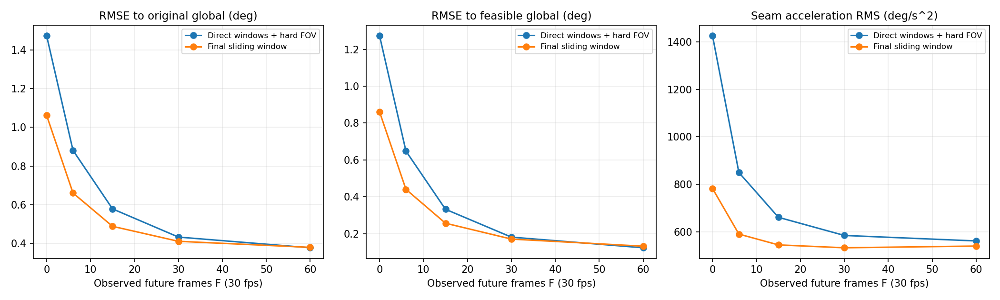
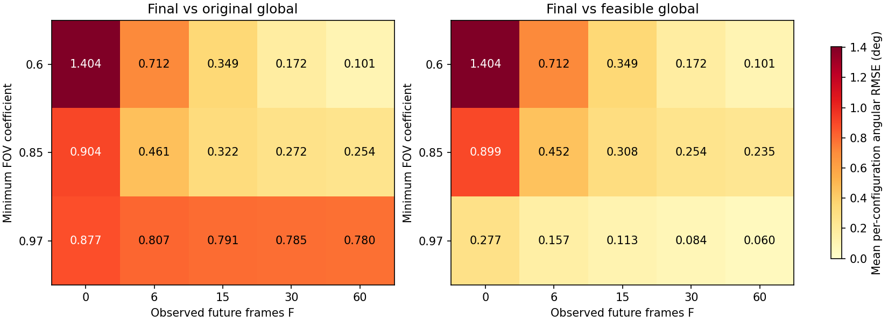
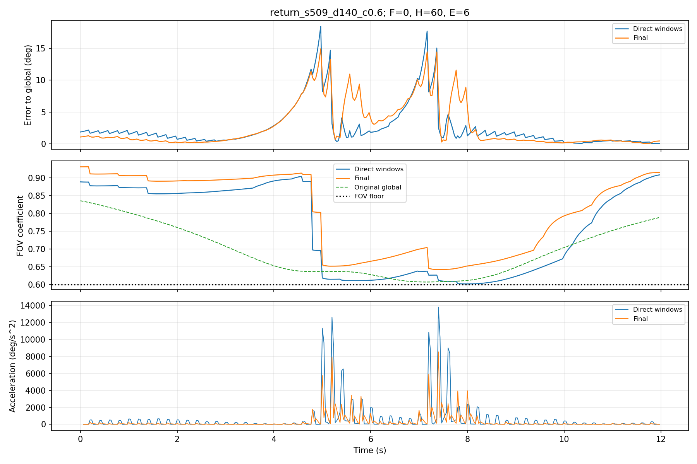
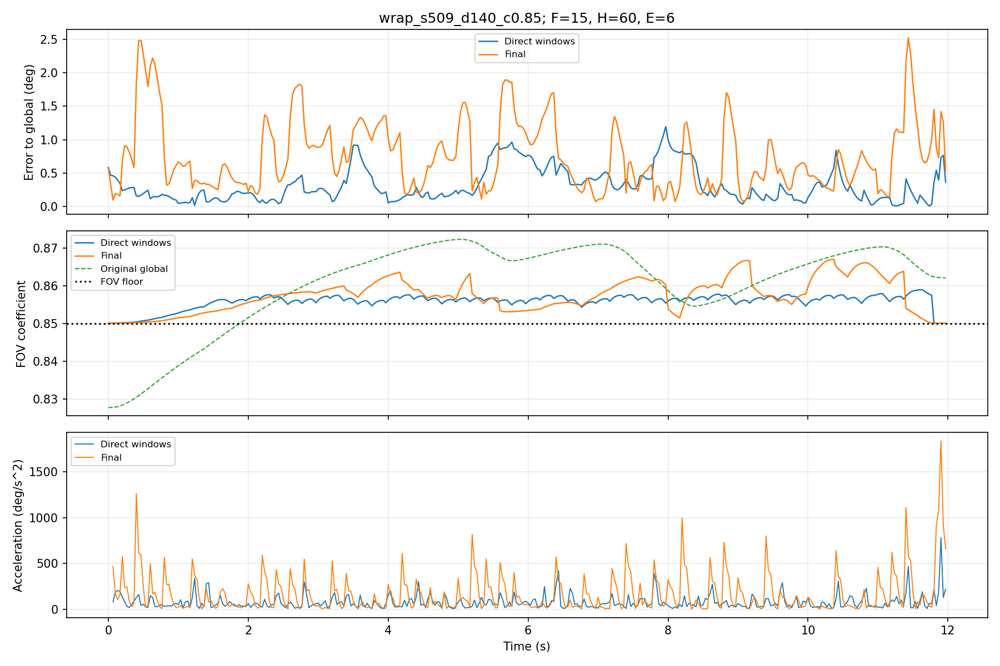
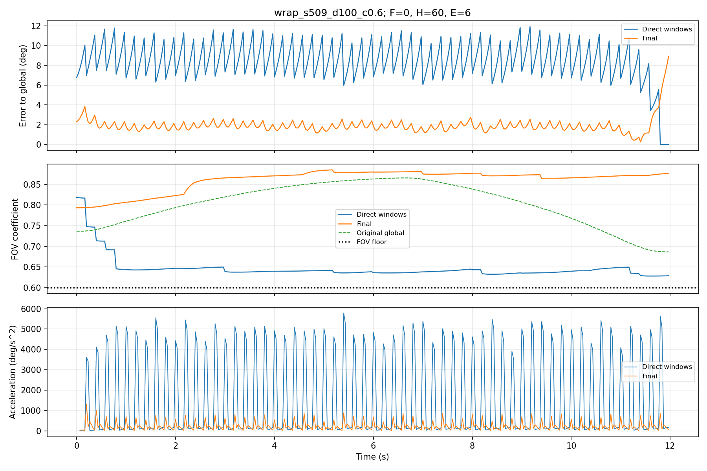

# Gyroflow 滑动窗口：迭代开发与实测结果

本文件由 `python -m gyroflow_window.report` 从已完成实验的 CSV 生成。算法细节、接口及边界条件见 [实现说明](gyroflow-sliding-window.md)。

## 1. 结论与比较口径

最终版本在 630 组窗口配置中，相比相同 H/E/F、同样强制 FOV 底线的直接分窗对照：

| 指标 | 直接分窗 | 最终窗口 | 均值下降比例 |
| --- | --- | --- | --- |
| 相对原版 Global 的姿态 RMSE | 0.7481 | 0.5995 | 19.87% |
| 相对可行 Global 的姿态 RMSE | 0.5114 | 0.3717 | 27.31% |
| 相对合成干净轨迹的 RMSE | 1.3592 | 1.2047 | 11.37% |
| 接缝角加速度 RMS | 816.6905 | 598.1694 | 26.76% |
| 非接缝角加速度 RMS | 552.0357 | 553.5862 | -0.28% |
| 全段角加速度 RMS | 695.3092 | 577.7457 | 16.91% |
| 缩放曲线 RMSE | 0.0510 | 0.0478 | 6.39% |

前三项角度单位为度；角加速度单位为 °/s²；缩放为无量纲系数。“均值”先对每个配置算 RMSE/RMS，再对配置等权平均，不是把所有帧混在一起计算一次 RMSE。降低均值不意味着每个运动、每个 F 都改善，退化配置见后文。

指标定义：姿态误差采用最短旋转角 `||Log(G_i⁻¹ S_i)||`，其中 Log 是 SO(3) 旋转向量，先算弧度再转成度。角速度采用世界坐标系增量 `ω_i = fps · Log(S_i S_(i-1)⁻¹)`，角加速度为 `a_i = fps · (ω_i - ω_(i-1))`。接缝统计取每个 E 帧输出块的前两帧，使二阶差分跨过提交边界，首块除外；非接缝统计其余位置。加速度既包含抖动，也包含真实有意运动，因此它是平顺性指标，不是单独的画质评分。

## 2. 验证数据与基线

- 最终验证 seed=[509]，运动类型 14 种：static、jitter、pan、stop_start、fast_turn、roll、walking、impulse、chirp、multi_axis、late_outlier、wrap、return、handheld。
- 镜头对角视场角 [60.0, 100.0, 140.0]°；FOV 底线 [0.6, 0.85, 0.97]；前瞻 F=[0, 6, 15, 30, 60]。
- H=60，E=6，30 fps，每段 12 秒。
- 126 组运动/镜头/底线组合，乘以 5 档 F 后，每个窗口算法 630 组。最终窗口累计检查 226,800 个“配置-帧”。
- 同一个运动随机种子的轨迹会被不同镜头、底线和 F 复用；这些配置不是独立拍摄的视频样本。
- Global 是固定参数、不分轴的源码逻辑 Python 移植，不是编译运行完整 Rust 引擎；全部比较共享理想针孔几何。

`global_safe` 是在 Global 输出后附加同样的逐帧 FOV 可行性投影，不是官方 Gyroflow 算法，也不是受约束全局最优解。`naive_safe` 关闭预测和边界修正，但保留同样的局部缩放迭代、硬 FOV 投影及缩放衔接。

| 算法 | 配置数 | Global RMSE/° | 可行 Global RMSE/° | 干净轨迹 RMSE/° | FOV 底线违约帧 | 覆盖违约帧 |
| --- | --- | --- | --- | --- | --- | --- |
| raw | 126 | 1.6205 | 1.3785 | 1.7477 | 0 | 0 |
| global | 126 | 0.0000 | 0.2711 | 0.9986 | 18230 | 0 |
| global_safe | 126 | 0.2711 | 0.0000 | 1.1865 | 0 | 0 |
| naive_safe | 630 | 0.7481 | 0.5114 | 1.3592 | 0 | 0 |
| final | 630 | 0.5995 | 0.3717 | 1.2047 | 0 | 0 |

全段基线不依赖 F，因此只计算一次，没有人为重复五份；其镜头/运动/底线权重与窗口表一致。

原版 Global 的最大底线缺口为 0.18376，逐帧缺口均值为 0.02905。底线违约指裁剪超过所允许的最大放大倍率，不等于画面露黑；两者单独统计。原版外层迭代是有限次软反馈，不能把它误当作严格底线保证。

## 3. 六轮开发与被否定的方案

不同轮次的运动、F 和镜头矩阵不同，只能在同一轮内比较，不应把各轮均值直接串成下降曲线。round1–4 使用 seed=11；随后 seed=101 的扩展诊断发现周期运动误预测和长 F 过度修正，因此该诊断不再算独立验证，round5–6 使用它继续开发。最终冻结后才使用 seed=509。

| 轮次 | 方案 | 配置数 | Global RMSE/° | 干净轨迹 RMSE/° | 接缝 RMS/(°/s²) |
| --- | --- | --- | --- | --- | --- |
| round1 | naive_safe | 90 | 0.5321 | 1.0830 | 1046.56 |
| round1 | anchored | 90 | 0.7458 | 1.2101 | 974.37 |
| round1 | predictive | 90 | 0.6521 | 1.1479 | 969.71 |
| round1 | stable_scale | 90 | 0.6526 | 1.1522 | 971.17 |
| round2 | p0_b0 | 16 | 0.7907 | 0.9526 | 1027.25 |
| round2 | p1.5_b0 | 16 | 0.6027 | 0.8400 | 964.11 |
| round2 | p1.5_b1 | 16 | 0.6183 | 0.8482 | 805.09 |
| round3 | p1.5_b1_t0.3 | 24 | 0.5870 | 1.1685 | 901.27 |
| round3 | p1.5_b1_t0.6 | 24 | 0.5826 | 1.1719 | 904.67 |
| round3 | p1.5_b1_t1.2 | 24 | 0.5856 | 1.1772 | 909.26 |
| round3 | p1.5_b1_t3 | 24 | 0.5916 | 1.1823 | 914.24 |
| round4 | naive_safe | 72 | 0.9056 | 1.3696 | 1351.42 |
| round4 | tuned | 72 | 0.7073 | 1.1875 | 1039.40 |
| round4 | denoised | 72 | 0.6694 | 1.1483 | 1028.41 |
| round5 | naive_safe | 42 | 0.9788 | 1.5839 | 1035.66 |
| round5 | denoised | 42 | 0.9353 | 1.5237 | 867.43 |
| round5 | adaptive06 | 42 | 0.8258 | 1.3685 | 789.19 |
| round5 | adaptive09 | 42 | 0.8398 | 1.3759 | 787.63 |
| round5 | adaptive12 | 42 | 0.8472 | 1.3880 | 782.11 |
| round6 | naive_safe | 48 | 0.9314 | 1.4748 | 1045.63 |
| round6 | adaptive06 | 48 | 0.7988 | 1.2873 | 821.47 |
| round6 | guard09 | 48 | 0.8112 | 1.3282 | 836.71 |
| round6 | guard12 | 48 | 0.8030 | 1.3257 | 830.78 |
| round6 | guarded06 | 48 | 0.7946 | 1.2896 | 812.17 |

- round1：强边界权重 64 虽压低接缝加速度，却明显偏离 Global；跨窗口最大偏差尺度没有稳定收益，未设为默认。
- round2–3：降低边界权重、加长虚拟尾部；在有限网格上比较 0.3/0.6/1.2/3 秒预测衰减，保留 0.6 秒。
- round4：用回归末端代替直接复制最后一帧，减少噪声向虚拟尾部传播。
- 扩展诊断：原 0.3 秒趋势会把行走摆动误判成持续转动；长 F 下额外修正有时降低轨迹精度。原结果保留在 `validation`。
- round5：比较 0.6/0.9/1.2 秒趋势拟合，并使边界权重随真实 F 衰减。更长拟合虽抑制摆动，也更容易滞后突然转向。
- round6：比较长短两尺度可信度组合，最终保留 `guarded06`：0.6 秒短拟合、1.2 秒长期检查、自适应边界权重。

最终参数：H=60、E=6、F=15；边界基础权重 1；虚拟尾部 1.5 秒；预测速度衰减 0.6 秒；末端修正最多 2°；角速度上限 180°/s；缩放最多反馈 5 次后再做硬投影。全部场景使用同一套规则，没有按运动类别分支。

## 4. 真实前瞻 F 与精度/延迟

| F/帧 | 批内等待范围/s | 直接分窗 RMSE/° | 最终 RMSE/° | 最终可行参考 RMSE/° | 直接接缝 RMS | 最终接缝 RMS |
| --- | --- | --- | --- | --- | --- | --- |
| 0 | 0.000–0.167 | 1.4742 | 1.0620 | 0.8601 | 1425.8 | 782.5 |
| 6 | 0.200–0.367 | 0.8809 | 0.6600 | 0.4402 | 850.0 | 590.5 |
| 15 | 0.500–0.667 | 0.5777 | 0.4874 | 0.2564 | 661.2 | 544.9 |
| 30 | 1.000–1.167 | 0.4317 | 0.4097 | 0.1703 | 584.8 | 532.8 |
| 60 | 2.000–2.167 | 0.3762 | 0.3784 | 0.1317 | 561.6 | 540.1 |

等待范围从批内最后一帧到最早一帧，不含计算耗时。F=0 仍可能因 E 帧组批产生等待。虚拟尾部只用已观测数据预测，不增加真实前瞻或等待时间。

此矩阵中收益集中在较短前瞻；F=60 时最终方案的平均轨迹误差略高于直接分窗，但接缝角加速度仍较低。因此不能把增加预测/边界处理理解为所有 F 下都提高姿态精度。



## 5. FOV 底线与精度

以下是最终窗口“相对原版 Global RMSE / 相对可行 Global RMSE”，单位为度。不能只看高底线时对原版 Global 的误差：该参考本身可能使用了不允许的裁剪量。

| FOV 底线 | F=0 | F=6 | F=15 | F=30 | F=60 |
| --- | --- | --- | --- | --- | --- |
| 0.6 | 1.4043 / 1.4043 | 0.7118 / 0.7118 | 0.3489 / 0.3489 | 0.1724 / 0.1724 | 0.1008 / 0.1008 |
| 0.85 | 0.9045 / 0.8988 | 0.4611 / 0.4517 | 0.3224 / 0.3075 | 0.2718 / 0.2542 | 0.2543 / 0.2347 |
| 0.97 | 0.8771 / 0.2772 | 0.8070 / 0.1570 | 0.7909 / 0.1126 | 0.7850 / 0.0843 | 0.7801 / 0.0595 |



0.60、0.85、0.97 的底线在同尺寸模型中分别对应最大约 1.667×、1.176×、1.031× 放大。高底线留给旋转补偿的余量很小，因此更多原始抖动必须保留。

## 6. 不隐瞒退化：逐配置与最差案例

| 指标 | 改善配置数 | 相同配置数 | 退化配置数 |
| --- | --- | --- | --- |
| 相对原版 Global 的姿态 RMSE | 306 | 45 | 279 |
| 相对可行 Global 的姿态 RMSE | 298 | 45 | 287 |
| 相对合成干净轨迹的 RMSE | 339 | 45 | 246 |
| 接缝角加速度 RMS | 564 | 45 | 21 |
| 非接缝角加速度 RMS | 247 | 45 | 338 |
| 全段角加速度 RMS | 519 | 45 | 66 |

相同包含无抖动静止场景。判定容差为 1e-8，对所有配置等权计数；这些数量不是独立样本显著性检验，也不能用均值改善替代逐场景结论。

按最终姿态误差排序的五个最差配置：

| 案例 | F | 直接分窗/° | 最终/° | 最终可行参考/° | 最终逐帧最大误差/° |
| --- | --- | --- | --- | --- | --- |
| return_s509_d140_c0.6 | 0 | 4.1707 | 4.3489 | 4.3489 | 14.9095 |
| roll_s509_d140_c0.6 | 0 | 4.7445 | 3.6537 | 3.6537 | 13.2055 |
| wrap_s509_d140_c0.6 | 0 | 8.8354 | 3.3805 | 3.3805 | 7.4161 |
| return_s509_d100_c0.6 | 0 | 3.4803 | 3.3159 | 3.3159 | 12.2567 |
| fast_turn_s509_d140_c0.6 | 0 | 2.4858 | 2.8345 | 2.8345 | 15.5624 |

最大绝对误差配置：`return_s509_d140_c0.6`，F=0。



相对直接分窗退化最多：`wrap_s509_d140_c0.85`，F=15；RMSE 从 0.4033° 变为 0.9095°。



相对直接分窗改善最多：`wrap_s509_d100_c0.6`，F=0；RMSE 从 8.6794° 变为 2.0834°。



预测不能知道观测区外的突然转向和停止；F 很小时，趋势延续有可能预测错误。此外，固定历史、局部归一化和最终几何投影都会使窗口结果不同于离线 Global。硬投影能确保模型可行性，但不保证角速度、角加速度或 jerk 的硬上限。

## 7. 性能、缓冲与额外设置验证

平台：Windows-11-10.0.26200-SP0；Python 3.13.9；NumPy 2.3.5。首轮预热记录 0.443 秒，未计入以下算法运行耗时。

| 算法 | 每 12 秒片段平均计算/s | 各配置窗口 P95 均值/ms | 实测最慢窗口/ms | 真实帧缓冲峰值 |
| --- | --- | --- | --- | --- |
| naive_safe | 0.299 | 7.418 | 25.464 | 126 |
| final | 0.370 | 8.757 | 36.446 | 126 |

这是桌面预热后的 Python/Numba 实测，不是手机耗时承诺；P95 一列是各配置 P95 的均值，不是所有窗口的联合 P95。126 帧对应 H=60、E=6、F=60 的最大配置；默认 F=15 时上限为 81 帧。额外内存还包括虚拟尾部、差分矩阵、临时数组、调用者输入批次及输出。

| 补充实验 | 算法 | fps/H/E | 配置数 | Global RMSE/° | 接缝 RMS | 底线违约 | 覆盖违约 |
| --- | --- | --- | --- | --- | --- | --- | --- |
| robustness_final_60fps | naive_safe | 60/60/3 | 24 | 1.2786 | 2755.8 | 0 | 0 |
| robustness_final_60fps | final | 60/60/3 | 24 | 0.8623 | 1932.4 | 0 | 0 |
| robustness_final_short_h | naive_safe | 30/15/12 | 16 | 0.9036 | 1158.7 | 0 | 0 |
| robustness_final_short_h | final | 30/15/12 | 16 | 0.7496 | 653.2 | 0 | 0 |

额外实验同样使用冻结参数；其 F、镜头、种子和运动定义以对应 metadata.json 为准。不同 fps、H、E 的矩阵不能直接用均值比较优劣。

## 8. 复现、原始证据与适用边界

- [最终逐配置 CSV](../experiments/gyroflow_window/validation_final/metrics.csv)
- [最终参数、代码 SHA256 与环境](../experiments/gyroflow_window/validation_final/metadata.json)
- [最终源码快照](../experiments/gyroflow_window/validation_final/source_snapshot/)
- [最终逐帧输入/输出轨迹 NPZ](../experiments/gyroflow_window/validation_final/trajectories/)
- [60 fps 补充实验](../experiments/gyroflow_window/robustness_final_60fps/metrics.csv)
- [短 H/大 E 补充实验](../experiments/gyroflow_window/robustness_final_short_h/metrics.csv)

```powershell
python -m pytest gyroflow_window/test_smoothing.py -q
python -m gyroflow_window.build_bundle
python -m gyroflow_window.report
```

完整主验证命令见 [实现说明](gyroflow-sliding-window.md#72-正式验证矩阵)。各轮 metadata.json 保存全部生成参数，round2 起还保存运行时源码快照；修改参数后请使用新的输出目录，避免覆盖原始证据。

约束检查容差为 1e-8；可行性投影还留有浮点安全余量。单元测试覆盖独立 SciPy 核心核对、四元数符号/坐标系不变性、几何覆盖、FOV=1、空/短片段、任意拆包、输出不可变、真实前瞻预算、收尾，以及单文件有/无 Numba 的一致性。

所有“无覆盖违约”结论仅适用于此纯旋转、无畸变、无滚动快门的针孔模型。没有真实图像、镜头标定、平移/视差、运动模糊或主观播放评测；不能据此声称真实 App 已经达到相同画质或不会露黑。Global 基线经过源码移植和独立计算核对，尚未与编译后的完整 Gyroflow 引擎逐帧比较。
