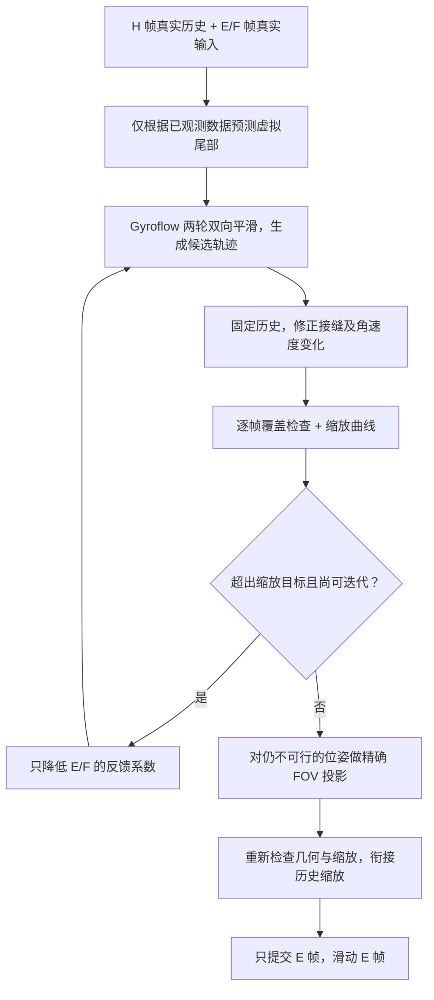

# Gyroflow 滑动窗口平滑：实现、实验与接入说明

本项目提供一个 Global Python 对照、一个严格限制真实前瞻的滑动窗口实现，以及可复现的合成数据实验。窗口算法经过六轮开发对照和一次扩展场景诊断后冻结，再使用未参与调参的随机种子进行最终验证。前一次诊断发现问题后用于继续开发，不算最终独立验证。

主交付是 [单文件版本](../dist/gyroflow_sliding_window.py)。详细实测表、不同 FOV 和 F 下的结果以及最差案例见 [实验结果](gyroflow-sliding-window-results.md)。原版算法的逐步分析见 [Global 平滑与缩放迭代说明](gyroflow-global-smoothing-and-zoom-limit.md)。

## 1. 交付内容与适用范围

| 内容 | 文件 |
|---|---|
| 可单独复制使用的窗口实现 | [dist/gyroflow_sliding_window.py](../dist/gyroflow_sliding_window.py) |
| 窗口算法源文件 | [sliding_window.py](../gyroflow_window/sliding_window.py) |
| Global 对照实现 | [gyroflow_global.py](../gyroflow_window/gyroflow_global.py) |
| 四元数基础运算 | [math3d.py](../gyroflow_window/math3d.py) |
| 相机覆盖检查和 FOV 可行性投影 | [geometry.py](../gyroflow_window/geometry.py) |
| 合成运动生成器 | [synthetic.py](../gyroflow_window/synthetic.py) |
| 实验程序 | [benchmark.py](../gyroflow_window/benchmark.py) |
| 核对与接口测试 | [test_smoothing.py](../gyroflow_window/test_smoothing.py) |
| Python 依赖 | [requirements.txt](../gyroflow_window/requirements.txt) |

Global 对照基于 Gyroflow 提交 `2331ebb3c253fc7cf357642518b0c8bf2937f815`，移植了默认不分轴平滑、两轮前后向 SLERP、角速度与偏差权重、EnvelopeFollower 缩放，以及默认最多 5 次的缩放反馈。

实验采用固定参数、固定帧率，每个视频帧一个姿态四元数。它不包含传感器积分、真实镜头畸变、滚动快门、地平线锁定、关键帧、变速和裁剪区间处理。Global 与窗口版本共用同一个精确针孔几何模型，确保比较时几何条件一致。

四元数平滑核心还与独立的 SciPy Rotation 标量实现进行了数值核对。这属于源码移植核对和独立运算实现验证；本环境没有编译运行完整 Gyroflow Rust 引擎。

## 2. 窗口与提交协议

设本次第一帧输出编号为 k：

```text
[k-H ... k-1] | [k ... k+E-1] | [k+E ... k+E+F-1]
  已提交历史H  |   本次提交E    |     已观测前瞻F
   位姿固定    |   本次求解     |     结果仍可修改
```

一次求解只提交 E 帧，随后前进 E 帧。已提交的位姿和缩放均不会修改。流式实现保留的真实姿态缓冲不超过 H+E+F 帧。

默认值是 H=60、E=6、F=15、30 fps，即真实窗口最多 81 帧。一个批次中，最早输出帧需要等待约 `(E+F-1)/fps` 秒，最后一帧等待 `F/fps` 秒；默认约 0.667～0.5 秒，另加计算时间。

H 用于历史热身及接缝约束，F 提供真实未来信息，E 决定批量提交频率。增大 E 也会增加一批中较早帧的等待时间。

### 2.1 `push` 的输入含义

第一次通常推入 E+F 帧，之后每次只推入新增的 E 帧。也允许每次推 1 帧或不规则大小的批次，内部会按同一窗口边界提交，结果不依赖外部拆包方式。

`push()` 接收的是新数据，不要重复推入已经处理过的整个 H+E+F 窗口。历史由实例内部保存。

### 2.2 收尾

`flush()` 表示视频真正结束，处理不足完整前瞻的剩余帧。最后一个批次可能不足 E 帧。收尾时关闭虚拟未来预测，使用实际末端边界。

`flush()` 可重复调用，后续返回空列表；结束后继续 `push()` 会抛出异常。处理另一段视频应新建实例。

## 3. 最终保留的算法

最终流程为：



每次缩放迭代都重新处理同一份原始窗口。前一轮的平滑结果不会作为下一轮的原始相机运动输入。H 的最终位姿保持固定。

### 3.1 用真实 H 帧热身

当前实现使用原始 H 帧作为滤波热身区，保留已提交的 H 帧输出、反馈系数和缩放边界。它没有保存原版两轮滤波在整段历史上的所有逐阶段 IIR 检查点。

因此 H 太短时仍会出现左端截断误差。这里的实现选择了容易复现和接入的固定大小历史缓冲；H 的影响应和 F 一起实测，不能认为仅保存最后一个最终位姿就能重现全部滤波状态。

### 3.2 有衰减的末端预测

双向滤波的右端初始化对短 F 尤其敏感。最终版本从末尾约 0.6 秒的已观测姿态中估计局部转动趋势，同时用末尾约 1.2 秒检查趋势是否持续。历史不足时只使用已经收到的样本：

1. 在最后一个观测姿态附近，用世界坐标系下的旋转向量表示最近的姿态。
2. 做线性拟合，得到角速度和拟合末端。
3. 根据拟合残差计算短期、长期置信度（类似 R²）；速度同时乘以两者，抑制只有一小段看起来线性的周期摆动。
4. 将预测角速度上限限制为 180°/s，并让它按 0.6 秒时间常数衰减。
5. 向右生成 1.5 秒的虚拟姿态。

预测位移的主要形式为：

$$
\Delta\theta(t)=\hat\omega\,\tau_p(1-e^{-t/\tau_p})
$$

虚拟尾部的起点使用拟合末端，最多偏离最后一个真实观测 2°。长期置信度高时主要采用短期拟合末端，否则更多采用长期拟合末端。这个修正用于避免将最后一帧的随机抖动复制到整个预测尾部。

较长拟合区间可减小行走、扫频等周期运动被误判为持续转动的问题，但不能彻底消除，也会在突然转向时引入滞后。它不是一个知道运动类别的分类器；所有场景都使用相同规则。

这里的 1.5 秒是由已知数据生成的预测，未读取额外未来帧，也不增加视频等待时间。30 fps 下内部会额外计算 45 个虚拟姿态，因此计算工作量不只等于真实 H+E+F 个点。虚拟点只帮助滤波初始化，几何约束只检查真实帧；归一化的最大值统计也排除虚拟尾部。

预测无法提前知道尚未观测到的转向、撞击或停止。它主要改善稳定运动和带噪末端的截断误差。

### 3.3 固定历史的边界修正

候选轨迹记为 Y，修正后轨迹写为：

$$
S_i=\operatorname{Exp}(\delta_i)Y_i
$$

修正量采用统一世界坐标系。算法使用历史最后两帧和候选 E+F 帧，构造角速度增量的二阶差分，并进行一次局部线性化求解：

$$
\min_\delta\ \|\delta\|^2+\lambda\|b+D\delta\|^2
$$

其中 b 为候选轨迹的角速度差分，D 是二阶差分算子。历史修正量固定为零，只求解 E+F 的变量：

$$
(I+\lambda D^TD)\delta=-\lambda D^Tb
$$

系统具有带状结构，用带状 Cholesky 分解求解；相同窗口长度的分解会缓存。最终默认 `boundary_weight=1.0`，再根据本次实际可用前瞻衰减：

$$
\lambda_{\mathrm{eff}}=\frac{\lambda}{1+(F_{\mathrm{actual}}/(0.5\,fps))^2}
$$

30 fps 下 F=0、15、60 对应约 1、0.5、0.059。这样在真实前瞻较长、候选本来已经较接近 Global 时，减少额外修正造成的偏移。`adaptive_boundary=False` 可以关闭这一衰减。

目标函数按离散帧角增量定义，没有按 fps⁴ 换算成连续时间加速度代价；换帧率后不保证相同物理频率响应，补充实验单独验证了 60 fps 情况。

这是一次 SO(3) 切空间近似修正，用于抑制接缝处角速度突变。它没有承诺严格的角加速度或 jerk 上界，也不是完整非线性优化的精确解。强裁剪约束触发后续投影时，平顺程度仍可能退让。

### 3.4 第二轮偏差归一化的实际选择

最终默认仍使用真实窗口内的最大值归一化，保留原版第二轮的主要行为。另实现了 `stable_distance_scale=True` 的跨窗口尺度方案，并在开发实验中作对照。

跨窗口尺度方案没有表现出稳定的综合收益，因此没有作为默认值。它保留为实验选项，不应把前期设计建议误认为最终默认算法已经采用的行为。

### 3.5 局部缩放反馈

每个窗口开始时，未提交 E+F 的反馈系数重新初始化为 1；H 的反馈值来自此前提交。这样避免同一个 F 帧在多个窗口中被反复只减不增。

每轮检查边界修正后的最终候选，超限时仅更新 E+F：

$$
c_j\leftarrow c_j\min(F_j/F_{\min},t_k)
$$

阈值依次为 0.95、0.90、0.85、0.80，之后保持 0.80。默认最多反馈 5 次。

### 3.6 FOV 硬约束和最终投影

原版缩放反馈是有限次的近似调整。窗口版本在迭代结束后，还对未满足 FOV 底线的真实帧做几何可行性投影。

每个不满足约束的位姿沿着到原始姿态的最短旋转弧收缩：

$$
S(t)=\operatorname{SLERP}(Q_{\mathrm{raw}},S_{\mathrm{candidate}},t),\qquad t\in[0,1]
$$

原始姿态在本实验相机模型下对应 FOV=1，是可行起点。30 次二分搜索始终保留一个已验证可行的端点，最后再检查一次几何条件。浮点检查仍不满足时回退到原始姿态。

这保证的是当前针孔模型下的画面覆盖及设定底线。搜索不声称找到了整个旋转弧上全部可能可行区间中的全局最优点。投影可能增加运动残留或加速度，这种代价应通过实测指标判断。

## 4. FOV 的精确定义和覆盖检查

输入输出使用相同宽高比和基准尺寸。设针孔图像在归一化成像平面上的半宽、半高为 tx、ty，输出 FOV 系数为 c。输出角点射线为：

$$
r=[\pm c\,t_x,\;\pm c\,t_y,\;1]^T
$$

将它映射到真实相机：

$$
r_{\mathrm{in}}=R(Q_{\mathrm{raw}})^TR(S)r
$$

每个角点必须位于输入视锥内：z 为正，且 x/z、y/z 不超过对应图像边界。这些约束关于 c 是线性的，代码直接求交得到最大的安全 c。

`minimum_fov` 是这个无量纲成像平面尺度的下限，镜头的 `diagonal_fov_deg` 则是以度表示的视场角，两者需要区分。

| FOV 底线 | 同尺寸情况下对应的最大放大倍率 |
|---:|---:|
| 0.60 | 约 1.667 倍 |
| 0.85 | 约 1.176 倍 |
| 0.97 | 约 1.031 倍 |
| 1.00 | 1 倍；本实现直接跟随原始姿态 |

底线越高，允许的旋转补偿空间越小。强烈抖动下，严格保留视野与彻底消除抖动会发生冲突。

缩放曲线使用原版包络算法作为候选，再从已提交的缩放状态衔接：需要裁剪时及时收紧，释放裁剪时平缓变化。最终输出同时检查 `minimum_fov <= fov <= geometric_fov`。

## 5. 快速使用

推荐使用 Python 3.11 或更新版本。Python、平台和 NumPy 版本记录在各实验目录的 `metadata.json` 中。Numba 用于加速递推；没有安装时存在纯 Python 回退，但吞吐会下降。

记录实验使用 Python 3.13.9，完整依赖版本见 [requirements-tested.txt](../gyroflow_window/requirements-tested.txt)。单文件运行只需要 NumPy、SciPy，Numba 可选；Matplotlib 和 pytest 用于实验报告及测试。

```powershell
python -m pip install -r gyroflow_window/requirements.txt
```

### 5.1 单文件命令行

输入可以是 `(N,4)` 的 `.npy`，或者含有 `raw` / `orientations` 数组的 `.npz`。

```powershell
python dist/gyroflow_sliding_window.py input.npy --output output.npz --fps 30 --history 60 --emit 6 --future 15 --minimum-fov 0.85 --diagonal-fov 100
```

输出包含：

- `orientations`：平滑后的相机到世界姿态，wxyz 排列。
- `fov`：逐帧实际输出的裁剪尺度。
- `geometric_fov`：该姿态下针孔模型允许的最大安全尺度。

这里返回的 `orientations` 是平滑姿态本身。图像重映射时，输出射线到输入相机使用 `inverse(raw) * smooth`；若采用相反映射方向，需要相应取逆。

### 5.2 流式接入

将单文件放在 Python 可导入的位置：

```python
from gyroflow_sliding_window import (
    PinholeCamera, SmoothingConfig, WindowConfig, SlidingWindowStabilizer
)

stream = SlidingWindowStabilizer(
    config=SmoothingConfig(fps=30, minimum_fov=0.85),
    window=WindowConfig(history=60, emit=6, future=15),
    camera=PinholeCamera(diagonal_fov_deg=100, aspect=16/9),
)

for new_orientations in incoming_batches:  # shape (N,4), wxyz
    for batch in stream.push(new_orientations):
        consume(batch.start_index, batch.orientations, batch.fov)

for batch in stream.flush():
    consume(batch.start_index, batch.orientations, batch.fov)
```

每条流使用独立实例。输入必须为有限、非零四元数；算法会归一化输入，并支持 q 与 -q 的符号变化。当前接口要求等间隔姿态采样，帧率、相机和 FOV 底线在一个实例内固定。

生产接口默认不累计全部诊断日志。`collect_diagnostics=True` 可用于调试，但会额外保存每窗口日志。批处理辅助函数会收集完整输出和日志，本身自然需要与视频长度对应的输出内存。

真实帧缓冲是有界的；预测数组、四元数中间数组和边界求解矩阵也占用额外内存。当前边界实现缓存差分矩阵，额外空间不能简单按 H+E+F 个四元数估算。

### 5.3 参数调整

| 参数 | 默认值 | 含义/范围 |
|---|---:|---|
| `history / emit / future` | 60 / 6 / 15 | 帧数；分别要求整数 H≥2、E≥1、F≥0 |
| `boundary_weight` | 1.0 | 离散角增量二阶差分的基础权重；0 为关闭 |
| `adaptive_boundary` | True | 随实际 F 增大而减弱上述权重 |
| `prediction_seconds` | 1.5 s | 虚拟尾部长度；0 为关闭预测 |
| `prediction_fit_seconds` | 0.6 s | 短期趋势拟合区间 |
| `prediction_guard_seconds` | 1.2 s | 长期可信度检查区间；0 为关闭 |
| `prediction_decay_seconds` | 0.6 s | 预测角速度的衰减时间常数 |
| `prediction_endpoint_fit` | True | 使用拟合后的尾部起点 |
| `stable_distance_scale` | False | 未被选中的跨窗偏差归一化实验选项 |
| `hard_fov` | True | 最后进行几何可行性投影 |
| `SmoothingConfig.minimum_fov` | 0.8 | (0,1]；无量纲视野保留底线 |
| `SmoothingConfig.max_iterations` | 5 | 初始平滑之后最多反馈重算次数 |

Global 基础滤波参数默认 `smoothness=0.5`、`slow_seconds=1.0`、`fast_seconds=0.1`、`zoom_seconds=4.0`。改变这些参数会改变候选轨迹，也可能需要重新评估预测长度和 H/F。

- F 较小时更依赖预测，未知的突发运动误差也更大。
- H 太短会加大左侧热身误差；它不能替代缺失的真实未来信息。
- 较大的 E 减少提交频率，但增加批次内最早帧的延迟。
- `boundary_weight` 越大，接缝更受平滑约束，也可能增加相对 Global 的轨迹偏差。
- `prediction_seconds=0` 可以关闭虚拟尾部；它会改变短 F 下的精度和接缝表现。
- `hard_fov=False` 仅保留近似缩放迭代，不再提供严格底线，主要用于消融实验。

### 5.4 同一份输入上比较 Global 与窗口

单文件中也保留了 Global 基础实现，便于快速对照；它与独立源文件 [gyroflow_global.py](../gyroflow_window/gyroflow_global.py) 来自同一份代码。

```python
from gyroflow_sliding_window import (
    stabilize_global, stabilize_window, angular_distance,
    SmoothingConfig, WindowConfig, PinholeCamera,
)
import numpy as np

config = SmoothingConfig(fps=30, minimum_fov=0.85)
camera = PinholeCamera(diagonal_fov_deg=100)
global_result = stabilize_global(raw_wxyz, config, camera)
window_result = stabilize_window(
    raw_wxyz, config, WindowConfig(history=60, emit=6, future=15), camera
)
errors_deg = np.rad2deg(angular_distance(
    global_result.orientations, window_result.orientations
))
print("angular RMSE (deg):", np.sqrt(np.mean(errors_deg**2)))
```

这是方便离线分析的包装。App 端持续输入应使用 `SlidingWindowStabilizer`；每处理一段就重新调用批处理函数，会丢失跨段历史。

## 6. 精度评价与实验设计

Global 输出是对照算法，不是相机真实意图的唯一标准。实验同时统计：

1. 对原始 Global 输出的四元数测地角 RMSE、P95、最大误差。
2. 对 `global_safe` 的误差：在原版 Global 输出后添加相同 FOV 投影，以区分硬裁剪约束造成的差异。
3. 对生成器已知干净轨迹的误差。这个指标取决于合成运动对“意图”的定义。
4. 整体及窗口接缝处的角加速度 RMS。
5. FOV 底线违约帧、独立角点检查发现的覆盖违约帧、最大底线缺口。
6. 每窗口耗时、运行时缓冲上界及实际提交前瞻。

`global_safe` 是附加的可行性对照，不是原版 Gyroflow 的输出，也不代表满足裁剪约束的全局最优解。

比较中的 `naive_safe` 使用同样大小的真实窗口、同样缩放迭代和最终 FOV 投影，但关闭预测及边界修正。它保持历史输出不可变，提供直接分窗处理的对照。

测试包含静止、纯抖动、匀速转动、启停、快速转向、大幅 roll、行走、冲击、扫频抖动、三轴复合运动、末段强离群冲击、跨越 180°/360°、转动返回及随机手持运动，并随机翻转四元数符号。

最初开发集使用 seed=11；扩展诊断和后两轮开发使用 seed=101。最终独立验证使用 seed=509；补充测试使用其他种子和不同 H/E/fps。最终验证期间不再根据结果调整默认参数。目录 `validation` 是先前诊断结果，最终交付应看 `validation_final`。

## 7. 复现实验

### 7.1 测试

```powershell
python -m pytest gyroflow_window/test_smoothing.py -q
```

测试包括独立 SciPy 平滑核心对照、旋转坐标系与四元数符号不变性、几何覆盖、硬 FOV 投影、无未来信息泄漏、历史输出不变、输入拆包无关性、提交索引、短视频和真实结束处理。

交付版本的运行结果是 `24 passed`，也包含生成的单文件在有/无 Numba 时与模块版本的输出一致性测试。

### 7.2 正式验证矩阵

```powershell
python -m gyroflow_window.benchmark --output experiments/gyroflow_window/validation_final --motions static,jitter,pan,stop_start,fast_turn,roll,walking,impulse,chirp,multi_axis,late_outlier,wrap,return,handheld --seeds 509 --lenses 60,100,140 --floors 0.6,0.85,0.97 --futures 0,6,15,30,60 --seconds 12 --variants naive_safe,final --save-trajectories
```

每次实验保存 CSV 指标、JSON 参数和代码散列、源码快照及可选轨迹 NPZ。`round1` 至 `round6` 保存开发期对照；当时的参数和源码快照应以各目录实际内容为准。最早 `round1` 尚未加入源码快照功能，保留了指标和参数记录。

预热阶段（包括可能的 JIT 编译或缓存载入）单独计时，表中的窗口运行时间主要反映预热后的本机执行。它不能直接作为手机端性能保证，也不等于首次无缓存启动的编译耗时。

### 7.3 生成单文件

```powershell
python -m gyroflow_window.build_bundle
```

单文件由已测试模块机械合并，包含四元数、几何、Global 基础实现和滑动窗口实现。修改算法时应修改源模块并重新生成，避免源码与交付文件产生分歧。

## 8. 接入真实 App 前需要验证的边界

本实验验证纯旋转、无畸变的针孔画面覆盖。真实 App 应使用实际标定、画面尺寸、滚动快门和最终重映射方式重新实现或接入几何检查；这些因素会改变允许的 FOV。

有限前瞻通常不能与整段 Global 完全一致。高 FOV 底线下，保留视野需要让输出更接近原始相机运动；位置可行性投影也可能增大加速度。详细报告保留失败或退步的配置及最差案例，不能只依据均值决定产品参数。

算法只处理相机旋转，未模拟平移、视差、运动模糊和图像内容。最终视觉质量还需要真实视频回放验证。

源码来源和许可证说明见 [NOTICE](../gyroflow_window/NOTICE.md)，许可证全文见 [LICENSE](../gyroflow_window/LICENSE)。移植部分及单文件分发保留 GPL-3.0-or-later 标识，不能当作无许可证限制的示例代码。
